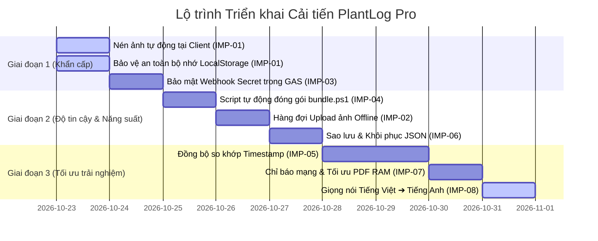

# 📋 KẾ HOẠCH CẢI TIẾN VÀ TỐI ƯU HÓA HỆ THỐNG PLANTLOG PRO
*(System Improvement & Optimization Plan)*

> **Dự án:** VCS PlantLog Pro  
> **Ngày lập kế hoạch:** 22/10/2026  
> **Trạng thái:** Chờ phê duyệt & Triển khai theo giai đoạn  
> **Đường dẫn tệp:** `d:\AI Lean\Plantlog-pro-main\IMPROVEMENT_PLAN.md`  

---

## 1. 🎯 MA TRẬN PHÂN LOẠI ƯU TIÊN VÀ TÍNH CẤP THIẾT

Các hạng mục cải tiến được đánh giá và phân loại dựa trên 3 tiêu chí cốt lõi:
1. **Mức độ rủi ro (Risk):** Nguy cơ mất mát dữ liệu hoặc lỗi hệ thống nghiêm trọng.
2. **Tính cần thiết (Necessity):** Mức độ ảnh hưởng trực tiếp đến công việc hàng ngày của kỹ sư hiện trường.
3. **Mức độ ưu tiên (Priority):**
   * **🔴 P0 (Khẩn cấp / Bắt buộc làm ngay):** Ảnh hưởng sống còn đến tính toàn vẹn dữ liệu, có nguy cơ gây lỗi ngay khi dùng thực tế.
   * **🟠 P1 (Ưu tiên cao / Rất cần thiết):** Ảnh hưởng đến độ tin cậy khi chạy offline, bảo mật hệ thống và quy trình bảo trì mã nguồn.
   * **🟡 P2 (Ưu tiên trung bình / Cần thiết):** Cải thiện khả năng chống xung đột dữ liệu và cơ chế cứu dữ liệu khi đổi thiết bị.
   * **🟢 P3 (Ưu tiên thấp / Cải thiện UX):** Tối ưu hóa giao diện và trải nghiệm tương tác hàng ngày.

---

### Bảng Tổng Hợp Các Hạng Mục Cải Tiến (Đã hoàn thành & Đang triển khai)

| Mã | Hạng mục cải tiến | Mức độ ưu tiên | Tính cần thiết | Trạng thái | Thời gian |
|:---:|---|:---:|:---:|:---:|:---:|
| **IMP-01** | **Nén ảnh tại client & Chống tràn LocalStorage** | 🔴 **P0** | **Bắt buộc** | ✅ Hoàn tất (v4.9) | 0.5 ngày |
| **IMP-02** | **Hàng đợi Upload ảnh khi Offline (Background Queue)** | 🟠 **P1** | **Rất cần thiết** | ✅ Hoàn tất (v4.9) | 0.5 ngày |
| **IMP-03** | **Bảo mật Webhook Secret & Token trong Apps Script** | 🟠 **P1** | **Rất cần thiết** | ✅ Hoàn tất (v4.9) | 0.5 ngày |
| **IMP-04** | **Script tự động đóng gói (Automated Bundler Script)** | 🟠 **P1** | **Rất cần thiết** | ✅ Hoàn tất (v4.9) | 0.5 ngày |
| **IMP-05** | **Đồng bộ 2 chiều chống xung đột (Per-Item Timestamp Merge)** | 🟡 **P2** | **Cần thiết** | ✅ Hoàn tất (v4.9) | 1.0 ngày |
| **IMP-06** | **Sao lưu / Khôi phục dữ liệu thủ công (Backup/Restore JSON)** | 🟡 **P2** | **Cần thiết** | ✅ Hoàn tất (v4.9) | 0.5 ngày |
| **IMP-07** | **Tối ưu RAM khi xuất PDF & Chỉ báo trạng thái mạng trực quan** | 🟢 **P3** | **Khuyến nghị** | ✅ Hoàn tất (v4.9) | 0.5 ngày |
| **IMP-08** | **Voice-to-Text Tiếng Việt tự động dịch sang Tiếng Anh** | 🎙️ **P2** | **Cần thiết** | ✅ Hoàn tất (v4.9) | 0.5 ngày |
| **IMP-09** | **Tính & Hiển thị Số tuần trong năm (ISO-8601 Week Number)** | 📅 **P2** | **Cần thiết** | ✅ Hoàn tất (v4.10) | 0.25 ngày |
| **IMP-10** | **Đồng bộ thanh Bottom Navigation chuẩn 5 tab trên toàn bộ màn hình** | 🔴 **P1** | **Rất cần thiết** | ✅ Hoàn tất (v4.11) | 0.5 ngày |
| **IMP-11** | **Custom Dialogs Native Sheet (Xóa bỏ hoàn toàn prompt/confirm browser)** | 🔴 **P1** | **Rất cần thiết** | ✅ Hoàn tất (v4.11) | 0.5 ngày |
| **IMP-12** | **Responsive mở rộng Tablet/Laptop & Kanban 3 cột song song** | 🟠 **P2** | **Cần thiết** | ✅ Hoàn tất (v4.11) | 0.5 ngày |
| **IMP-13** | **Chế độ Giao diện Ban đêm (Dark Mode Industrial Slate)** | 🟠 **P2** | **Cần thiết** | ✅ Hoàn tất (v4.11) | 0.5 ngày |
| **IMP-14** | **Chuẩn hóa Touch Targets (≥ 44px) & Rung phản hồi (Haptic Feedback)** | 🟠 **P2** | **Cần thiết** | ✅ Hoàn tất (v4.11) | 0.25 ngày |
| **IMP-15** | **Nâng cấp Canvas Chữ ký số Sắc Nét Retina (High-DPI Scaling)** | 🟡 **P3** | **Khuyến nghị** | ✅ Hoàn tất (v4.11) | 0.25 ngày |
| **IMP-16** | **Thanh tiến độ % hoàn thành trên Trip Card & Widget Tổng chi phí** | 🟡 **P3** | **Khuyến nghị** | ✅ Hoàn tất (v4.11) | 0.25 ngày |
| **IMP-17** | **Lối tắt Lịch & Kế hoạch (Calendar & Leave Planner Quick Access)** | 🔴 **P1** | **Rất cần thiết** | ✅ Hoàn tất (v4.12) | 0.25 ngày |
| **IMP-18** | **Khôi phục Chữ ký Báo cáo & Quản lý Chữ ký Cá nhân (Signature Engine)** | 🔴 **P1** | **Rất cần thiết** | ✅ Hoàn tất (v4.12) | 0.5 ngày |
| **IMP-19** | **Nhật ký & Bảng chấm công hiện trường (Daily Service Ticket & Supervisor Timesheet)** | 🔴 **P1** | **Rất cần thiết** | ✅ Hoàn tất (v4.13) | 0.5 ngày |
| **IMP-20** | **Tình trạng nghiệm thu máy (Machine Readiness) & Danh mục Spare Parts** | 🔴 **P1** | **Rất cần thiết** | ✅ Hoàn tất (v4.13) | 0.5 ngày |
| **IMP-21** | **Hộp công cụ Kỹ thuật Cơ - Điện - Đo lường (Field Engineering Toolbox)** | 🟠 **P2** | **Cần thiết** | ✅ Hoàn tất (v4.13) | 0.5 ngày |
| **IMP-22** | **Sổ tay ghi chú nhanh & Chụp Nameplate (Quick Scratchpad & Snapper)** | 🟠 **P2** | **Cần thiết** | ✅ Hoàn tất (v4.13) | 0.5 ngày |
| **IMP-23** | **An toàn EHS, Giấy phép công tác & 4 bước LOTO (Site Safety Checklist)** | 🔴 **P1** | **Rất cần thiết** | ✅ Hoàn tất (v4.13) | 0.5 ngày |
| **IMP-24** | **Hồ sơ lý lịch thiết bị & Dòng thời gian bảo trì (Asset Passport & Timeline)** | 🟠 **P2** | **Cần thiết** | ✅ Hoàn tất (v4.13) | 0.5 ngày |

---

## 2. 📝 CHI TIẾT KỸ THUẬT TỪNG HẠNG MỤC CẢI TIẾN

---

### 🔴 IMP-01: Nén ảnh tại Client & Chống tràn LocalStorage
* **Mức độ ưu tiên:** 🔴 **P0 (Khẩn cấp / Bắt buộc)**
* **Tính cần thiết:** Sống còn.
* **Hiện trạng & Vấn đề:**
  * Tại các hàm xử lý ảnh chụp: `handlePhoto` (dòng 5719) và `handleBillPhotos` (dòng 9604), file ảnh từ camera điện thoại (dung lượng từ 3MB – 12MB) được đọc trực tiếp thành chuỗi Base64 nguyên gốc qua `FileReader.readAsDataURL(f)`.
  * Sau đó chuỗi này được đưa vào mảng hóa đơn / sự cố và gọi hàm `sv()`.
  * Do `localStorage` của trình duyệt di động chỉ cho phép tối đa **5MB – 10MB**, chỉ cần 1 đến 2 bức ảnh là trình duyệt sẽ ném lỗi `QuotaExceededError`.
  * Vì hàm `sv()` bọc `catch(e) {}` không báo lỗi, ứng dụng sẽ âm thầm thất bại trong việc lưu trữ. Kỹ sư tưởng đã lưu nhưng khi tải lại trang, toàn bộ chuyến đi, nhiệm vụ, báo cáo vừa tạo sẽ **bị xóa sạch**.
* **Giải pháp kỹ thuật chi tiết:**
  1. Xây dựng hàm nén ảnh dùng chung `compressImageFile(file, maxDimension = 1280, quality = 0.72)`:
     * Sử dụng HTML5 `Image` và `Canvas` để scale kích thước lớn nhất về 1280px (giữ nguyên tỷ lệ khung hình).
     * Xuất ra chuỗi JPEG Base64 với chất lượng nén 0.72. Dung lượng giảm từ **8MB xuống còn ~150KB - 250KB** (giảm 97% dung lượng nhưng văn bản trên hóa đơn vẫn cực kỳ sắc nét).
  2. Bắt lỗi tại hàm `sv()`: Nếu `localStorage` báo đầy, chủ động cảnh báo người dùng và đề xuất xóa bớt ảnh cũ hoặc dọn dẹp bộ nhớ đệm thay vì âm thầm bỏ qua.
  3. *(Tùy chọn nâng cao)*: Lưu ảnh offline vào `IndexedDB` (hỗ trợ lưu trữ hàng trăm MB) thay vì nhét chung chuỗi Base64 vào `localStorage`.

---

### 🟠 IMP-02: Hàng đợi Upload ảnh khi Offline (Background Media Queue)
* **Mức độ ưu tiên:** 🟠 **P1 (Ưu tiên cao)**
* **Tính cần thiết:** Rất cần thiết cho kỹ sư làm việc tại khu vực không có sóng.
* **Hiện trạng & Vấn đề:**
  * Hiện tại trong `saveBill()` (dòng 9438), nếu thiết bị đang có mạng, ảnh sẽ được đẩy lên Google Drive và thay thế bằng `driveUrl`.
  * Tuy nhiên, nếu kỹ sư đang ở tầng hầm, ngoài phân xưởng không có mạng, ảnh sẽ được lưu lại dạng Base64 nội bộ. Khi kỹ sư về nơi có Wi-Fi hoặc có mạng trở lại, **không có cơ chế nào tự động quét các ảnh Base64 cũ để đẩy bù lên Google Drive**.
* **Giải pháp kỹ thuật chi tiết:**
  1. Thêm trường hàng đợi `S.pendingMedia = [{ id, entity: 'bill'|'issue', localSrc, createdAt }]`.
  2. Bổ sung hàm tự động đồng bộ ảnh nền `flushPendingMedia()`:
     * Tự động kích hoạt khi có mạng (`window.addEventListener('online')`) hoặc mỗi lần người dùng bấm nút **Sync**.
     * Tuần tự tải từng ảnh lên Google Drive qua `uploadFileToDrive()`.
     * Khi upload thành công, cập nhật link `driveUrl` vào đúng Bill/Issue tương ứng và xóa khỏi hàng đợi.

---

### 🟠 IMP-03: Bảo mật Webhook Secret & Token trong Google Apps Script
* **Mức độ ưu tiên:** 🟠 **P1 (Ưu tiên cao)**
* **Tính cần thiết:** Rất cần thiết về mặt an toàn thông tin doanh nghiệp.
* **Hiện trạng & Vấn đề:**
  * Trong tệp [`PlantLog_GoogleAppsScript_Pro.gs`](file:///d:/AI%20Lean/Plantlog-pro-main/PlantLog_GoogleAppsScript_Pro.gs) (dòng 1200), biến `POWER_AUTOMATE_WEBHOOK_URL` đang chứa cả chuỗi ký bảo mật:
    `sig=cK6DoghVAr4x83_mCWPu3LK8s1PGL9HG1QHMxIwuMuU` được viết cứng trong code.
  * Nếu mã nguồn được tải về hoặc chia sẻ trong nội bộ, chữ ký bí mật này có thể bị lợi dụng để đẩy dữ liệu giả mạo vào Microsoft Lists của công ty.
  * Telegram Bot Token hiện đang được lưu trên client `localStorage` và gửi trực tiếp từ trình duyệt.
* **Giải pháp kỹ thuật chi tiết:**
  1. Xóa bỏ URL gán cứng trong mã nguồn. Chuyển sang đọc từ thuộc tính bảo mật đám mây:
     ```javascript
     var url = PropertiesService.getScriptProperties().getProperty('POWER_AUTOMATE_WEBHOOK_URL');
     ```
  2. Cung cấp một hàm thiết lập an toàn chạy 1 lần trong Apps Script (`setupSecretProperties()`).
  3. Chuyển việc gửi tin Telegram từ client sang server: Client gửi request `action: 'sendTelegram'` lên Apps Script; Apps Script tự lấy Token trong `ScriptProperties` để gửi tin, không để lộ Token trên trình duyệt người dùng.

---

### 🟠 IMP-04: Script Tự Động Đóng Gói Mã Nguồn (Automated Bundler Script)
* **Mức độ ưu tiên:** 🟠 **P1 (Ưu tiên cao)**
* **Tính cần thiết:** Rất cần thiết cho việc bảo trì lâu dài.
* **Hiện trạng & Vấn đề:**
  * Dự án có kiến trúc module rất tốt trong [`src/modules/`](file:///d:/AI%20Lean/Plantlog-pro-main/src/modules/), nhưng khi chạy thực tế lại dùng file gộp khổng lồ [`src/index.html`](file:///d:/AI%20Lean/Plantlog-pro-main/src/index.html) và [`plantlog_pro_mobile.html`](file:///d:/AI%20Lean/Plantlog-pro-main/plantlog_pro_mobile.html).
  * Hiện tại lập trình viên phải sửa tay đồng thời ở 4 vị trí: `src/modules/<file>.js`, `src/index.html`, `plantlog_pro_mobile.html` và `plantlog_debug.html`. Điều này gây tốn thời gian và rất dễ dẫn đến lỗi sót tính năng giữa các file.
* **Giải pháp kỹ thuật chi tiết:**
  1. Viết một script tự động hóa gọn nhẹ `bundle.ps1` (PowerShell) hoặc `build.js` (NodeJS thuần không cần cài thư viện npm):
     * Đọc các module từ thư mục `src/modules/` theo đúng thứ tự phụ thuộc (`core.js` ➔ `auth.js` ➔ `trips.js` ➔ `tasks.js` ➔ `report.js` ➔ `bills.js` ➔ `sync.js`...).
     * Tự động inject vào thẻ `<script>` của `src/index.html` và đồng bộ sang `plantlog_pro_mobile.html`.
     * Tự động tăng phiên bản cache trong `src/sw.js` (ví dụ: `plantlog-pro-v13` ➔ `v14`).
  2. Người phát triển chỉ cần tập trung chỉnh sửa các file nhỏ trong `src/modules/`, sau đó chạy `./bundle.ps1` là hoàn tất.

---

### 🟡 IMP-05: Đồng Bộ 2 Chiều Chống Xung Đột (Per-Item Timestamp Merge)
* **Mức độ ưu tiên:** 🟡 **P2 (Ưu tiên trung bình)**
* **Tính cần thiết:** Cần thiết khi có nhiều người cùng truy cập Sheets hoặc làm việc offline dài ngày.
* **Hiện trạng & Vấn đề:**
  * Cơ chế đồng bộ `loadFromSheets()` hiện tại tải toàn bộ dữ liệu từ Google Sheets về và thay thế toàn bộ mảng trong máy.
  * Mặc dù bản cập nhật v4.6 đã bảo vệ trạng thái của các mục hôm nay không bị hạ cấp về `planned`, nhưng nếu kỹ sư sửa một nhiệm vụ offline, trong khi ở Google Sheets người quản lý cập nhật một nhiệm vụ khác, việc đồng bộ kéo về có thể làm mất thông tin vừa sửa cục bộ.
* **Giải pháp kỹ thuật chi tiết:**
  1. Đảm bảo mọi đối tượng dữ liệu (`Trip`, `Task`, `Bill`) đều có trường `updatedAt` (ISO Timestamp).
  2. Khi kéo dữ liệu về từ Google Sheets, tiến hành gộp theo từng bản ghi (Per-Item Merge):
     * Nếu bản ghi trên máy có `local.updatedAt > remote.updatedAt` ➔ Giữ lại dữ liệu trên máy và đánh dấu cần đẩy lên Sheets.
     * Nếu bản ghi trên Sheets có `remote.updatedAt > local.updatedAt` ➔ Cập nhật dữ liệu mới từ Sheets vào máy.
     * Thêm các bản ghi mới xuất hiện trên Sheets mà dưới máy chưa có.

---

### 🟡 IMP-06: Sao Lưu & Khôi Phục Dữ Liệu Thủ Công (Backup / Restore JSON)
* **Mức độ ưu tiên:** 🟡 **P2 (Ưu tiên trung bình)**
* **Tính cần thiết:** Cần thiết để tạo sự an tâm tuyệt đối cho kỹ sư.
* **Hiện trạng & Vấn đề:**
  * Kỹ sư có thể gặp các sự cố bất ngờ: điện thoại bị hỏng màn hình, bị mất máy, hoặc vô tình bấm nút "Xóa dữ liệu trang web" trên Chrome/Safari trước khi kịp đồng bộ lên Google Sheets.
* **Giải pháp kỹ thuật chi tiết:**
  1. Thêm vào màn hình **Settings (Cài đặt)** mục **Data Management**:
     * **Nút "Xuất dữ liệu dự phòng (.json)":** Tải ngay file `PlantLog_Backup_YYYY-MM-DD.json` về bộ nhớ máy (chứa toàn bộ trips, tasks, bills, profile).
     * **Nút "Nhập dữ liệu dự phòng":** Cho phép chọn file `.json` đã lưu trước đó để khôi phục toàn bộ trạng thái làm việc khi chuyển sang máy mới.

---

### 🟢 IMP-07: Tối Ưu RAM Khi Xuất PDF & Chỉ Báo Trạng Thái Mạng
* **Mức độ ưu tiên:** 🟢 **P3 (Ưu tiên thấp / UX Polish)**
* **Tính cần thiết:** Khuyến nghị thực hiện để tăng độ mượt mà.
* **Chi tiết cải tiến:**
  1. **Chỉ báo kết nối mạng (Network Status Badge):** Hiển thị một chấm trạng thái nhỏ ở góc màn hình: `🟢 Đang kết nối` / `🟠 Đang Offline` giúp kỹ sư dễ dàng nhận biết trạng thái kết nối mạng thực tế.
  2. **Thanh tiến trình tạo PDF (Loading Indicator):** Thêm overlay loading "*Đang kết xuất PDF...*" khi bấm xuất báo cáo, tránh tình trạng màn hình bị khựng 2-3 giây khi trình duyệt di động render canvas khiến người dùng bấm nút nhiều lần.
  3. **Bộ lọc Hóa đơn nhanh:** Bổ sung thanh lọc nhanh hóa đơn chi phí theo 3 hình thức thanh toán (`1-Cash`, `2-Bank transfer`, `3-Credit card`) trên màn hình Bills.

---

### 🎙️ IMP-08: Nhập Giọng Nói Tiếng Việt ➔ Tự Động Dịch Sang Tiếng Anh & Lưu Ghi Chú
* **Mức độ ưu tiên:** 🟡 **P2 (Năng suất hiện trường cao)**
* **Tính cần thiết:** Rất cần cho kỹ sư thao tác rảnh tay khi đeo găng tay bảo hộ hoặc đang cầm dụng cụ kiểm tra máy móc tại nhà máy.
* **Chi tiết cải tiến:**
  1. **Nhận diện giọng nói Tiếng Việt (`vi-VN`):** Tích hợp Web Speech API ghi âm trực tiếp lời nói tiếng Việt của kỹ sư hiện trường với độ chính xác cao.
  2. **Dịch tự động sang Tiếng Anh chuẩn kỹ thuật:** Gọi API dịch tự động sang tiếng Anh ngay sau khi nói xong.
  3. **Điền và Lưu tự động:** Chèn đoạn tiếng Anh đã dịch vào ô ghi chú tương ứng (`trip-note-input`, `task-desc`, `is-desc`, `bill-notes`) và tự động lưu.
  4. **Cơ chế ngoại tuyến an toàn:** Nếu thiết bị đang ngoại tuyến (mất mạng), App tự động lưu lại văn bản tiếng Việt gốc để đảm bảo không thất thoát dữ liệu.

---

### 📅 IMP-09: Tính & Hiển thị Số tuần trong năm (ISO-8601 Week Number)
* **Mức độ ưu tiên:** 🟡 **P2**
* **Trạng thái:** ✅ Đã hoàn thành (v4.10)
* **Chi tiết:** Tự động tính số tuần chuẩn ISO-8601 (Week 1 – Week 52/53) từ ngày chuyến đi và hiển thị huy hiệu `W44/26` trên thẻ chuyến đi ở Home, Trips, và Trip Detail.

---

### 🔴 IMP-10: Đồng bộ hóa thanh Bottom Navigation Bar (Unified Bottom Navigation Shell)
* **Mức độ ưu tiên:** 🔴 **P1 (Ưu tiên cao)**
* **Tính cần thiết:** Sửa lỗi giao diện nhảy vị trí nút bấm khi chuyển trang.
* **Chi tiết cải tiến:**
  1. Thống nhất thanh điều hướng cố định chuẩn 5 tab trên toàn bộ các màn hình:
     `Home 🏠` | `Trips 📋` | `Tasks ✅` | `Bills 💳` | `Settings ⚙️`
  2. Bổ sung hàm `updateBottomNav(activeScreen)` tự động cập nhật trạng thái `.active` chính xác cho tab đang mở.
  3. Đảm bảo trải nghiệm chuyển màn hình mượt mà, không bị giật hay đổi thứ tự nút bấm.

---

### 🔴 IMP-11: Custom Dialogs Native Sheet (Xóa bỏ hoàn toàn window.prompt & confirm)
* **Mức độ ưu tiên:** 🔴 **P1 (Ưu tiên cao)**
* **Tính cần thiết:** Loại bỏ hộp thoại thô của trình duyệt, nâng tầm PWA chuẩn Native Mobile.
* **Chi tiết cải tiến:**
  1. Xây dựng 2 hàm `appConfirm(message, options)` và `appPrompt(message, defaultValue, options)` trả về Promise.
  2. Giao diện dạng Bottom Sheet sang trọng, hỗ trợ nút xác nhận nổi bật (màu đỏ khi xóa), tự động focus ô nhập và nhận phím Enter / Escape.
  3. Thay thế toàn bộ 18 vị trí đang dùng `window.confirm` và `window.prompt` trong hệ thống (xóa bill, xóa task, xóa chuyến đi, xóa dữ liệu, thêm thiết bị mới, thêm kế hoạch mới...).

---

### 🟠 IMP-12: Responsive Mở Rộng Tablet/Laptop & Bảng Kanban 3 Cột Song Song
* **Mức độ ưu tiên:** 🟠 **P2 (Ưu tiên trung bình)**
* **Tính cần thiết:** Tận dụng tối đa màn hình lớn khi kỹ sư dùng iPad, máy tính bảng hoặc Laptop.
* **Chi tiết cải tiến:**
  1. Thiết lập CSS Responsive: Cho phép container `#app` mở rộng tối đa `920px - 1040px` trên màn hình `>= 768px`.
  2. Bảng Kanban tự động dàn thành 3 cột song song (Pending, In Progress, Done) có cuộn riêng biệt từng cột thay vì xếp chồng hẹp.
  3. Mở rộng modal dạng popup giữa màn hình trên máy tính bảng để thao tác thoải mái.

---

### 🟠 IMP-13: Chế độ Giao diện Ban đêm (Dark Mode Industrial Slate)
* **Mức độ ưu tiên:** 🟠 **P2 (Ưu tiên trung bình)**
* **Tính cần thiết:** Chống mỏi mắt khi làm việc ban đêm, trong buồng máy tối và tiết kiệm pin OLED.
* **Chi tiết cải tiến:**
  1. Bổ sung bộ biến màu CSS `[data-theme="dark"]` với bảng màu than chì công nghiệp (`#0B131E`, card `#15202E`, border `#233348`, text `#F1F5F9`).
  2. Lưu cấu hình vào State `S.theme` (`'auto'` | `'light'` | `'dark'`).
  3. Bổ sung nút chuyển đổi giao diện trong màn hình Cài đặt (Settings).

---

### 🟠 IMP-14: Chuẩn hóa Touch Targets (≥ 44px) & Rung phản hồi (Haptic Feedback)
* **Mức độ ưu tiên:** 🟠 **P2 (Ưu tiên trung bình)**
* **Tính cần thiết:** Chống bấm trượt khi kỹ sư đeo găng tay bảo hộ hoặc đang di chuyển tại hiện trường.
* **Chi tiết cải tiến:**
  1. Mở rộng kích thước vùng bấm tối thiểu đạt 44px x 44px cho tất cả các nút nhỏ (nút xóa, nút checklist, nút icon).
  2. Tích hợp `triggerHaptic(type)` sử dụng Web Vibration API: Rung nhẹ 12ms khi bấm Pass/Fail checklist, hoàn thành nhiệm vụ hoặc đổi trạng thái.

---

### 🟡 IMP-15: Nâng cấp Canvas Chữ ký số Sắc Nét Retina (High-DPI Scaling)
* **Mức độ ưu tiên:** 🟡 **P3 (Khuyến nghị)**
* **Tính cần thiết:** Tăng tính chuyên nghiệp của chữ ký số khi xuất PDF báo cáo.
* **Chi tiết cải tiến:**
  1. Tự động scale độ phân giải Canvas ký duyệt theo `window.devicePixelRatio`.
  2. Khắc phục triệt để hiện tượng chữ ký bị mờ, răng cưa trên iPhone, iPad và màn hình Retina.

---

### 🟡 IMP-16: Thanh tiến độ % hoàn thành trên Thẻ Chuyến đi & Widget Tổng Chi phí
* **Mức độ ưu tiên:** 🟡 **P3 (Khuyến nghị)**
* **Tính cần thiết:** Nắm bắt tiến độ và chi phí công tác tức thì.
* **Chi tiết cải tiến:**
  1. Hiển thị thanh tiến độ mini trên mỗi Trip Card: `[██████░░░░] 3/5 tasks (60%)`.
  2. Hiển thị Widget tóm tắt chi phí tổng của chuyến đi trong Trip Detail: `💰 Total Expenses: X.XXX.XXX VND (N bills)`.

---

### 🔴 IMP-17: Lối tắt Lịch & Kế hoạch (Calendar & Leave Planner Quick Access)
* **Mức độ ưu tiên:** 🔴 **P1 (Ưu tiên cao)**
* **Tính cần thiết:** Rất cần thiết. Tránh việc kỹ sư phải vào tận Settings để xem lịch công tác và kế hoạch ngày nghỉ.
* **Chi tiết cải tiến:**
  1. **Clickable Stat Cards:** Cả 3 thẻ thống kê trên Dashboard Trang chủ (`Trips`, `Tasks today`, `Leave days`) có thể bấm trực tiếp (`onclick`), trong đó thẻ `Leave days` chuyển ngay sang `screen-leave`.
  2. **Nút Lịch trên Header Trips & Tasks:** Bổ sung nút `📅` ngay trên thanh Topbar của màn hình Trips và Tasks cạnh nút `＋`, tránh làm chật thanh tiêu đề Trang chủ giúp dòng lời chào kỹ sư luôn hiển thị trọn vẹn, thoáng đẹp.
  3. **Lối tắt trên màn hình Tasks:** Thêm nút `📅` trên Topbar màn hình Tasks cạnh nút `+ Add Task` để kỹ sư chuyển nhanh sang xem lịch.
  4. **Điều hướng quay lại thông minh:** Nút `←` trên `screen-leave` tự động ghi nhớ màn hình trước đó (`window._prevScreen`) để quay về đúng nơi xuất phát.

---

### 🔴 IMP-18: Khôi phục Chữ Ký Báo Cáo & Quản Lý Chữ Ký Cá Nhân (Signature Engine)
* **Mức độ ưu tiên:** 🔴 **P1 (Ưu tiên cao)**
* **Tính cần thiết:** Rất cần thiết. Khắc phục triệt để lỗi không nạp được chữ ký khi mở lại báo cáo và nâng cao năng suất nghiệm thu.
* **Chi tiết cải tiến:**
  1. **Khôi phục chữ ký khi xem bước Sign-off (`gotoStep(5)`):** Xây dựng hàm `renderReportSignature()` tự động nạp `curReport.signature` lên Canvas khi Bước 6 thực sự hiển thị trên DOM.
  2. **Chuẩn hóa Retina High-DPI:** Tính toán tọa độ và kích thước ảnh vẽ theo hệ tọa độ CSS, khắc phục hoàn toàn lỗi chữ ký bị phóng to 4x - 9x văng ra ngoài khung nhìn do `scale(dpr, dpr)`.
  3. **Lưu chữ ký cá nhân mặc định (`S.profile.signature`):** Kỹ sư có thể tải ảnh chữ ký lên trong mục Cài đặt (Settings ➔ Profile) hoặc bấm "💾 Lưu mặc định" (`saveSignatureAsDefault`) ngay tại màn hình ký.
  4. **Nạp & Tải chữ ký đa năng:**
     * Nút **"✍️ Dùng chữ ký của tôi"** ưu tiên lấy chữ ký cá nhân từ Profile và tự động lưu vào State.
     * Nút **"📁 Tải ảnh"** (`handleSignatureFileUpload`) cho phép chọn tệp ảnh chữ ký từ máy ảnh/thư viện điện thoại.
     * Tự động lưu chuỗi Base64 chữ ký vào `curReport.signature` ngay khi nhả tay/bút vẽ (`mouseup`, `touchend`).

---

### 🔴 IMP-19: Nhật ký & Bảng chấm công hiện trường (Daily Service Ticket & Supervisor Timesheet)
* **Mức độ ưu tiên:** 🔴 **P1 (Ưu tiên cao / Rất cần thiết)**
* **Tính cần thiết:** Tối quan trọng cho kỹ sư đi service nhiều ngày (Multi-day Field Service).
* **Chi tiết cải tiến:**
  1. **Bảng phân bổ thời gian chi tiết:** Chia rõ số giờ: Giờ hành chính (Normal Hours), Làm thêm ngoài giờ (OT 1.5x), Làm đêm/Chủ nhật (OT 2.0x), Chờ đợi hiện trường (Standby/Idle) và Thời gian di chuyển (Travel Hours).
  2. **Chữ ký xác nhận hàng ngày của Giám sát Nhà máy:** Tích hợp Canvas vẽ chữ ký xác nhận trực tiếp bằng ngón tay/bút cảm ứng kèm tên người giám sát phía khách hàng cho từng ngày công tác.
  3. **Tự động tổng hợp Timesheet:** Tổng hợp toàn bộ số giờ làm việc thực tế, OT và Standby hiển thị trên thẻ tóm tắt và đồng bộ vào Báo cáo kỹ thuật cuối chuyến đi.

---

### 🔴 IMP-20: Tình trạng Bàn giao Máy (Machine Readiness Status) & Danh mục Spare Parts BOM
* **Mức độ ưu tiên:** 🔴 **P1 (Ưu tiên cao / Rất cần thiết)**
* **Tính cần thiết:** Tiêu chuẩn bàn giao kỹ thuật hiện trường chống tranh chấp trách nhiệm vận hành.
* **Chi tiết cải tiến:**
  1. **Tình trạng nghiệm thu 3 cấp độ (Traffic Light):**
     * 🟢 **Ready for Normal Operation:** Thiết bị an toàn, sẵn sàng chạy tải 100%.
     * 🟡 **Conditional / Monitored Operation:** Cho phép chạy có điều kiện kèm cảnh báo giám sát thông số.
     * 🔴 **Stop / Out of Service (Hazard):** Nghiêm cấm chạy, nguy cơ sự cố hoặc mất an toàn.
  2. **Ghi chú giới hạn vận hành:** Kỹ sư ghi rõ điều kiện tải, giới hạn nhiệt độ, áp suất hoặc vòng tua.
  3. **Khuyến nghị vật tư thay thế (Recommended Spare Parts BOM):** Cho phép lập danh sách mã phụ tùng (Part No), tên mô tả, số lượng và mức độ ưu tiên (🔴 Khẩn cấp - Critical, 🟡 Bảo trì tiếp theo - Next PM, ⚪ Dự phòng - Optional) ngay trong báo cáo và tự động in ra bảng biểu trong tệp PDF xuất ra cho khách hàng.

---

### 🟠 IMP-21: Hộp công cụ Kỹ thuật Cơ - Điện - Đo lường (Field Engineering Toolbox)
* **Mức độ ưu tiên:** 🟠 **P2 (Cần thiết)**
* **Tính cần thiết:** Hỗ trợ tính toán tra cứu nhanh 100% offline ngay dưới gầm máy hay trong phòng điều khiển.
* **Chi tiết cải tiến:**
  1. **Bộ chuyển đổi đơn vị Áp suất:** Tính toán 2 chiều tức thì giữa `bar`, `psi`, `kPa`, `MPa` và `kg/cm²`.
  2. **Bộ chuyển đổi Nhiệt độ & Lưu lượng:** Tính toán giữa `°C`, `°F`, `Kelvin` và lưu lượng `m³/h`, `L/min`, `GPM`.
  3. **Máy tính Dòng định mức Motor 3 pha (FLA Calculator):**
     * Công thức: $I = \frac{P \times 1000}{\sqrt{3} \times V \times \cos\varphi \times \eta}$.
     * Tự động đưa ra dòng định mức (FLA), khuyến nghị dải cài đặt Rơ-le nhiệt (Thermal Overload 1.05 - 1.15x), Cỡ Aptomat MCCB/MCB (1.5 - 2.5x) và tiết diện dây cáp đồng tối thiểu.
  4. **Bộ chia tỉ lệ tín hiệu Đo lường 4-20mA (Instrumentation Scaler):**
     * Tính toán nhanh 2 chiều giữa Dòng mA (4-20mA), Tỉ lệ % (0-100%) và Giá trị vật lý thực tế (Engineering Value: Bar, °C, RPM...) theo dải đo cài đặt (LRV - URV).

---

### 🟠 IMP-22: Sổ tay ghi chú nhanh & Chụp ảnh Nameplate (Quick Field Scratchpad & Snapper)
* **Mức độ ưu tiên:** 🟠 **P2 (Cần thiết)**
* **Tính cần thiết:** Bắt trọn thông tin máy móc nhãn mác (Nameplate) ngay tại hiện trường trong vài giây.
* **Chi tiết cải tiến:**
  1. **Chụp và nén ảnh Nameplate tức thời:** Nén ảnh tại chỗ (max 1000px, 0.72 quality) giữ chữ trên nhãn cực nét mà dung lượng cực nhẹ.
  2. **Phân loại thẻ thông minh (Category Chips):** Nameplate nhãn máy, Thông số cài đặt (Parameter), Báo động lỗi (Alarm), Ý tưởng ghi chú (Idea).
  3. **Tích hợp Voice-to-Text:** Nhập nhanh ghi chú hiện trường bằng giọng nói.
  4. **Chuyển đổi 1 chạm sang Task / Gắn vào Chuyến đi:** Chuyển ngay các ghi chú hiện trường thành Công việc (Task) cần làm hoặc liên kết vào Chuyến đi hiện tại.

---

### 🔴 IMP-23: An toàn Hiện trường EHS, Giấy phép Công tác & 4 Bước LOTO (Site Safety Checklist)
* **Mức độ ưu tiên:** 🔴 **P1 (Ưu tiên cao / Rất cần thiết)**
* **Tính cần thiết:** Tuân thủ an toàn lao động công nghiệp và bảo vệ kỹ sư tại nhà máy.
* **Chi tiết cải tiến:**
  1. **Giấy phép công tác (Work Permits):** Lưu số Permit, ngày hết hạn và đánh dấu các loại rủi ro cao (Làm việc trên cao, Không gian kín, Hàn cắt sinh nhiệt, Đào đất, Nâng hạ, Hóa chất độc hại).
  2. **Kiểm tra 4 điểm cô lập năng lượng (LOTO 4-Point Verification):**
     * [1] Cô lập nguồn điện (Electrical Power Isolated).
     * [2] Xả áp khí nén/thủy lực (Pneumatic/Hydraulic Depressurized).
     * [3] Treo thẻ cảnh báo (Danger Tags Hung).
     * [4] Kiểm tra thử năng lượng bằng 0 (Zero-Energy Verified & Tried).
  3. **Mã khóa an toàn & Ảnh bằng chứng LOTO:** Lưu số thẻ khóa Padlock ID và chụp ảnh hiện trường cụm van/aptomat đã khóa thẻ.
  4. **Quay số khẩn cấp 1 chạm (Emergency Call):** Nút gọi trực tiếp tới Phòng điều khiển trung tâm (CCR), Ban an toàn EHS và Trạm y tế nhà máy.

---

### 🟠 IMP-24: Quản lý Hồ sơ Lý lịch Thiết bị & Dòng thời gian Bảo trì (Asset Passport & Timeline)
* **Mức độ ưu tiên:** 🟠 **P2 (Cần thiết)**
* **Tính cần thiết:** Số hóa toàn bộ hồ sơ máy móc và tra cứu lịch sử sửa chữa của từng máy qua các năm.
* **Chi tiết cải tiến:**
  1. **Hồ sơ lý lịch máy móc (Machine Passport):** Lưu trữ Tag Number, Tên thiết bị, Khách hàng, Model, Serial No, Thông số kỹ thuật và Vị trí lắp đặt. Tự động chuyển đổi dữ liệu từ danh mục `S.machines` cũ để tương thích 100%.
  2. **Quét dòng thời gian lịch sử dịch vụ (Maintenance History Timeline):**
     * Tự động quét toàn bộ Chuyến đi (`S.trips`), Phiếu chấm công hàng ngày (`timesheets`), Nhật ký công việc (`S.tasks`) và Báo cáo (`S.reports`) để trích xuất toàn bộ các mốc bảo dưỡng, sửa chữa và thay thế liên quan đến thiết bị.
     * Hiển thị dòng thời gian trực quan theo thứ tự thời gian giúp kỹ sư biết rõ máy đã từng bị lỗi gì và ai đã sửa trước đó.
  3. **Gắn thẻ thiết bị nhanh:** Tự động tạo danh mục thẻ để chọn nhanh khi tạo Chuyến đi, Công việc hoặc Sổ tay ghi chú.

---

## 3. 📅 LỘ TRÌNH TRIỂN KHAI THEO GIAI ĐOẠN (ROADMAP)



### ✅ Checklist Tiến Độ Thực Hiện

- [x] **Giai đoạn 1: Khắc phục rủi ro mất dữ liệu & Bảo mật**
  - [x] Viết hàm `compressImageFile()` nén ảnh tự động trước khi lưu. (Đã xong - IMP-01)
  - [x] Tích hợp nén ảnh vào `handlePhoto()` và `handleBillPhotos()`. (Đã xong - IMP-01)
  - [x] Đưa `POWER_AUTOMATE_WEBHOOK_URL` vào Script Properties của Google Apps Script. (Đã xong - IMP-03)
- [x] **Giai đoạn 2: Tăng cường tính sẵn sàng Offline & Quy trình Code**
  - [x] Viết file script đóng gói `bundle.ps1` & `bundle.js`. (Đã xong - IMP-04)
  - [x] Bổ sung cơ chế `pendingMedia` upload ảnh bù khi có mạng. (Đã xong - IMP-02)
  - [x] Bổ sung tính năng Export / Import JSON trong Cài đặt. (Đã xong - IMP-06)
- [x] **Giai đoạn 3: Hoàn thiện tính năng nâng cao & Trải nghiệm**
  - [x] Cải tiến hàm đồng bộ so khớp `updatedAt` theo từng dòng. (Đã xong - IMP-05)
  - [x] Thêm trạng thái kết nối Online/Offline trực quan trên Header. (Đã xong - IMP-07)
  - [x] Thêm hiệu ứng Loading khi tạo file PDF và bộ lọc thanh toán Bills. (Đã xong - IMP-07)
  - [x] Tích hợp tính năng Voice-to-Text Tiếng Việt dịch sang Tiếng Anh (Đã xong - IMP-08)
  - [x] Tính & Hiển thị Số tuần trong năm chuẩn ISO-8601 `W44/26` trên Thẻ Chuyến đi (Đã xong - IMP-09)
- [x] **Giai đoạn 4: Hoàn thiện Trải nghiệm Người dùng (UI/UX) & Tương tác Hiện trường**
  - [x] Đồng bộ thanh Bottom Navigation chuẩn 5 tab có cập nhật active tab trên toàn bộ màn hình (Đã xong - IMP-10)
  - [x] Custom Dialogs thay thế hoàn toàn 18 lệnh `prompt()` và `confirm()` trình duyệt bằng modal sheet (Đã xong - IMP-11)
  - [x] Responsive layout mở rộng cho Tablet/Desktop với giao diện Kanban 3 cột ngang (Đã xong - IMP-12)
  - [x] Chế độ Dark Mode Industrial Slate với tự động nhận diện hệ điều hành và tùy chọn trong Settings (Đã xong - IMP-13)
  - [x] Chuẩn hóa kích thước vùng bấm Touch Target ≥ 44px và rung phản hồi Haptic Feedback qua Web Vibration API (Đã xong - IMP-14)
  - [x] Tối ưu hóa Canvas chữ ký số hỗ trợ màn hình Retina High-DPI siêu nét (Đã xong - IMP-15)
  - [x] Bổ sung thanh tiến độ công việc % trên Trip Card và Widget tổng chi phí trên Trip Detail (Đã xong - IMP-16)
- [x] **Giai đoạn 5: Tối ưu Điều hướng Lịch & Cơ chế Chữ ký Nghiệm thu (v4.12)**
  - [x] Lối tắt truy cập nhanh Lịch & Kế hoạch (Calendar & Leave Planner) từ Trang chủ (thẻ Leave days + nút Calendar Topbar) và màn hình Tasks (Đã xong - IMP-17)
  - [x] Khắc phục triệt để lỗi không nạp được chữ ký khi mở lại báo cáo qua cơ chế khôi phục tại Bước Sign-off (`gotoStep(5)`) (Đã xong - IMP-18)
  - [x] Tích hợp Quản lý Chữ ký Cá nhân trong Profile (Settings), hỗ trợ tải ảnh chữ ký, lưu chữ ký mặc định và dùng chữ ký cá nhân (Đã xong - IMP-18)
- [x] **Giai đoạn 6: Năng lực Kỹ sư Hiện trường & Dịch vụ Kỹ thuật Chuyên nghiệp (v4.13)**
  - [x] Nhật ký Dịch vụ & Bảng chấm công hiện trường với chữ ký giám sát nhà máy hàng ngày và phân tách giờ thường / OT 1.5x / OT 2.0x / Standby (Đã xong - IMP-19)
  - [x] Đèn giao thông tình trạng bàn giao máy (Machine Readiness Traffic Light) & Danh mục vật tư phụ tùng thay thế khuyến nghị (Spare Parts BOM) in trực tiếp ra PDF (Đã xong - IMP-20)
  - [x] Hộp công cụ Kỹ thuật Cơ - Điện - Đo lường Offline: chuyển đổi Áp suất, Nhiệt độ, Lưu lượng, Dòng động cơ 3 pha FLA và chia thang đo tín hiệu 4-20mA (Đã xong - IMP-21)
  - [x] Sổ tay ghi chú nhanh & Chụp ảnh Nameplate máy hiện trường: nén ảnh siêu nhẹ, Voice-to-Text và chuyển đổi 1 chạm sang Task / Trip (Đã xong - IMP-22)
  - [x] An toàn Hiện trường EHS, Giấy phép công tác & Kiểm tra 4 điểm cô lập năng lượng LOTO kèm ảnh hiện trường và gọi khẩn cấp 1 chạm (Đã xong - IMP-23)
  - [x] Quản lý Hồ sơ Lý lịch Thiết bị (Asset Passport) & Quét dòng thời gian lịch sử dịch vụ/bảo trì tự động từ Trips, Tasks, Reports (Đã xong - IMP-24)

---

## 4. 📌 DANH MỤC ĐỀ XUẤT XEM XÉT SAU (BACKLOG / FUTURE REVIEW)

Các hạng mục dưới đây đã được phân tích và lưu lại để xem xét khi có nhu cầu nâng cấp mở rộng trong tương lai:

1. **Chống "hồi sinh" bản ghi đã xóa khi Đồng bộ (Tombstone Pattern):**
   * *Mô tả:* Đánh dấu cờ `deleted: true` thay vì xóa mảng cục bộ, giúp Google Apps Script tự động gạch bỏ bản ghi trên Google Sheet tương ứng khi đồng bộ 2 chiều.
2. **Pre-cache thư viện jsPDF trong Service Worker:**
   * *Mô tả:* Tải trước tệp `jspdf.umd.min.js` vào bộ nhớ cache PWA để có thể kết xuất PDF trong điều kiện mất sóng điện thoại 100%.
3. **Nâng cấp kho lưu trữ từ LocalStorage sang IndexedDB:**
   * *Mô tả:* Mở rộng dung lượng lưu trữ cục bộ từ 5MB lên hàng trăm MB phục vụ lưu trữ nhiều năm dữ liệu.
