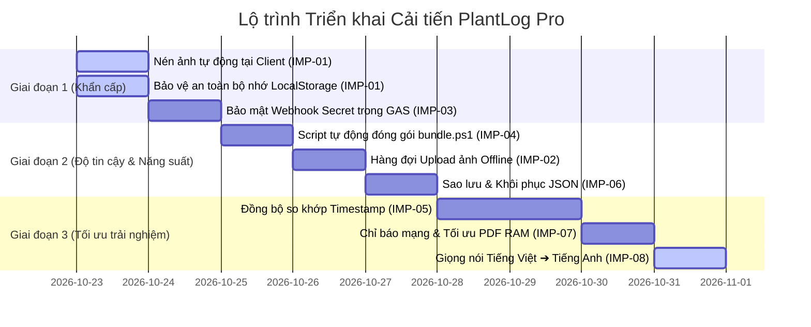

# 📋 KẾ HOẠCH CẢI TIẾN VÀ TỐI ƯU HÓA HỆ THỐNG PLANTLOG PRO
*(System Improvement & Optimization Plan)*

> **Dự án:** VCS PlantLog Pro  
> **Ngày lập kế hoạch:** 22/10/2026  
> **Trạng thái:** Chờ phê duyệt & Triển khai theo giai đoạn  
> **Đường dẫn tệp:** `d:\AI Lean\Plantlog-pro-main\IMPROVEMENT_PLAN.md`  

---

## 1. 🎯 MA TRẬN PHÂN LOẠI ƯU TIÊN VÀ TÍNH CẤP THIẾT

Các hạng mục cải tiến được đánh giá và phân loại dựa trên 3 tiêu chí cốt lõi:
1. **Mức độ rủi ro (Risk):** Nguy cơ mất mát dữ liệu hoặc lỗi hệ thống nghiêm trọng.
2. **Tính cần thiết (Necessity):** Mức độ ảnh hưởng trực tiếp đến công việc hàng ngày của kỹ sư hiện trường.
3. **Mức độ ưu tiên (Priority):**
   * **🔴 P0 (Khẩn cấp / Bắt buộc làm ngay):** Ảnh hưởng sống còn đến tính toàn vẹn dữ liệu, có nguy cơ gây lỗi ngay khi dùng thực tế.
   * **🟠 P1 (Ưu tiên cao / Rất cần thiết):** Ảnh hưởng đến độ tin cậy khi chạy offline, bảo mật hệ thống và quy trình bảo trì mã nguồn.
   * **🟡 P2 (Ưu tiên trung bình / Cần thiết):** Cải thiện khả năng chống xung đột dữ liệu và cơ chế cứu dữ liệu khi đổi thiết bị.
   * **🟢 P3 (Ưu tiên thấp / Cải thiện UX):** Tối ưu hóa giao diện và trải nghiệm tương tác hàng ngày.

---

### Bảng Tổng Hợp Các Hạng Mục Đề Xuất

| Mã | Hạng mục cải tiến | Mức độ ưu tiên | Tính cần thiết | Mức độ rủi ro nếu không sửa | Thời gian dự kiến |
|:---:|---|:---:|:---:|---|:---:|
| **IMP-01** | **Nén ảnh tại client & Chống tràn LocalStorage** | 🔴 **P0** | **Bắt buộc** | **Cực cao** (Tràn bộ nhớ 5MB `QuotaExceededError`, mất trắng dữ liệu khi chụp ảnh) | 0.5 ngày |
| **IMP-02** | **Hàng đợi Upload ảnh khi Offline (Background Queue)** | 🟠 **P1** | **Rất cần thiết** | **Cao** (Ảnh chụp khi mất mạng bị kẹt vĩnh viễn ở dạng Base64 trên máy) | 0.5 ngày |
| **IMP-03** | **Bảo mật Webhook Secret & Token trong Apps Script** | 🟠 **P1** | **Rất cần thiết** | **Cao** (Lộ URL và chữ ký bảo mật Webhook Power Automate trong mã nguồn) | 0.5 ngày |
| **IMP-04** | **Script tự động đóng gói (Automated Bundler Script)** | 🟠 **P1** | **Rất cần thiết** | **Trung bình** (Lệch code giữa `src/modules/`, `src/index.html` và file mobile) | 0.5 ngày |
| **IMP-05** | **Đồng bộ 2 chiều chống xung đột (Per-Item Timestamp Merge)** | 🟡 **P2** | **Cần thiết** | **Trung bình** (Ghi đè mất dữ liệu khi sửa offline đồng thời với Sheets) | 1.0 ngày |
| **IMP-06** | **Sao lưu / Khôi phục dữ liệu thủ công (Backup/Restore JSON)** | 🟡 **P2** | **Cần thiết** | **Trung bình** (Mất dữ liệu nếu kỹ sư xóa cache hoặc đổi điện thoại mới) | 0.5 ngày |
| **IMP-07** | **Tối ưu RAM khi xuất PDF & Chỉ báo trạng thái mạng trực quan** | 🟢 **P3** | **Khuyến nghị** | **Thấp** (Trình duyệt đơ tạm thời khi tạo PDF nhiều ảnh, thiếu nhận diện Online) | 0.5 ngày |
| **IMP-08** | **Voice-to-Text Tiếng Việt tự động dịch sang Tiếng Anh** | 🎙️ **P2** | **Cần thiết** | **Thấp** (Tối ưu năng suất ghi chú hiện trường) | 0.5 ngày |
| **IMP-09** | **Tính & Hiển thị Số tuần trong năm (ISO-8601 Week Number)** | 📅 **P2** | **Cần thiết** | **Thấp** (Theo dõi tiến độ và tuần công tác theo chuẩn W44/26) | 0.25 ngày |

---

## 2. 📝 CHI TIẾT KỸ THUẬT TỪNG HẠNG MỤC CẢI TIẾN

---

### 🔴 IMP-01: Nén ảnh tại Client & Chống tràn LocalStorage
* **Mức độ ưu tiên:** 🔴 **P0 (Khẩn cấp / Bắt buộc)**
* **Tính cần thiết:** Sống còn.
* **Hiện trạng & Vấn đề:**
  * Tại các hàm xử lý ảnh chụp: `handlePhoto` (dòng 5719) và `handleBillPhotos` (dòng 9604), file ảnh từ camera điện thoại (dung lượng từ 3MB – 12MB) được đọc trực tiếp thành chuỗi Base64 nguyên gốc qua `FileReader.readAsDataURL(f)`.
  * Sau đó chuỗi này được đưa vào mảng hóa đơn / sự cố và gọi hàm `sv()`.
  * Do `localStorage` của trình duyệt di động chỉ cho phép tối đa **5MB – 10MB**, chỉ cần 1 đến 2 bức ảnh là trình duyệt sẽ ném lỗi `QuotaExceededError`.
  * Vì hàm `sv()` bọc `catch(e) {}` không báo lỗi, ứng dụng sẽ âm thầm thất bại trong việc lưu trữ. Kỹ sư tưởng đã lưu nhưng khi tải lại trang, toàn bộ chuyến đi, nhiệm vụ, báo cáo vừa tạo sẽ **bị xóa sạch**.
* **Giải pháp kỹ thuật chi tiết:**
  1. Xây dựng hàm nén ảnh dùng chung `compressImageFile(file, maxDimension = 1280, quality = 0.72)`:
     * Sử dụng HTML5 `Image` và `Canvas` để scale kích thước lớn nhất về 1280px (giữ nguyên tỷ lệ khung hình).
     * Xuất ra chuỗi JPEG Base64 với chất lượng nén 0.72. Dung lượng giảm từ **8MB xuống còn ~150KB - 250KB** (giảm 97% dung lượng nhưng văn bản trên hóa đơn vẫn cực kỳ sắc nét).
  2. Bắt lỗi tại hàm `sv()`: Nếu `localStorage` báo đầy, chủ động cảnh báo người dùng và đề xuất xóa bớt ảnh cũ hoặc dọn dẹp bộ nhớ đệm thay vì âm thầm bỏ qua.
  3. *(Tùy chọn nâng cao)*: Lưu ảnh offline vào `IndexedDB` (hỗ trợ lưu trữ hàng trăm MB) thay vì nhét chung chuỗi Base64 vào `localStorage`.

---

### 🟠 IMP-02: Hàng đợi Upload ảnh khi Offline (Background Media Queue)
* **Mức độ ưu tiên:** 🟠 **P1 (Ưu tiên cao)**
* **Tính cần thiết:** Rất cần thiết cho kỹ sư làm việc tại khu vực không có sóng.
* **Hiện trạng & Vấn đề:**
  * Hiện tại trong `saveBill()` (dòng 9438), nếu thiết bị đang có mạng, ảnh sẽ được đẩy lên Google Drive và thay thế bằng `driveUrl`.
  * Tuy nhiên, nếu kỹ sư đang ở tầng hầm, ngoài phân xưởng không có mạng, ảnh sẽ được lưu lại dạng Base64 nội bộ. Khi kỹ sư về nơi có Wi-Fi hoặc có mạng trở lại, **không có cơ chế nào tự động quét các ảnh Base64 cũ để đẩy bù lên Google Drive**.
* **Giải pháp kỹ thuật chi tiết:**
  1. Thêm trường hàng đợi `S.pendingMedia = [{ id, entity: 'bill'|'issue', localSrc, createdAt }]`.
  2. Bổ sung hàm tự động đồng bộ ảnh nền `flushPendingMedia()`:
     * Tự động kích hoạt khi có mạng (`window.addEventListener('online')`) hoặc mỗi lần người dùng bấm nút **Sync**.
     * Tuần tự tải từng ảnh lên Google Drive qua `uploadFileToDrive()`.
     * Khi upload thành công, cập nhật link `driveUrl` vào đúng Bill/Issue tương ứng và xóa khỏi hàng đợi.

---

### 🟠 IMP-03: Bảo mật Webhook Secret & Token trong Google Apps Script
* **Mức độ ưu tiên:** 🟠 **P1 (Ưu tiên cao)**
* **Tính cần thiết:** Rất cần thiết về mặt an toàn thông tin doanh nghiệp.
* **Hiện trạng & Vấn đề:**
  * Trong tệp [`PlantLog_GoogleAppsScript_Pro.gs`](file:///d:/AI%20Lean/Plantlog-pro-main/PlantLog_GoogleAppsScript_Pro.gs) (dòng 1200), biến `POWER_AUTOMATE_WEBHOOK_URL` đang chứa cả chuỗi ký bảo mật:
    `sig=cK6DoghVAr4x83_mCWPu3LK8s1PGL9HG1QHMxIwuMuU` được viết cứng trong code.
  * Nếu mã nguồn được tải về hoặc chia sẻ trong nội bộ, chữ ký bí mật này có thể bị lợi dụng để đẩy dữ liệu giả mạo vào Microsoft Lists của công ty.
  * Telegram Bot Token hiện đang được lưu trên client `localStorage` và gửi trực tiếp từ trình duyệt.
* **Giải pháp kỹ thuật chi tiết:**
  1. Xóa bỏ URL gán cứng trong mã nguồn. Chuyển sang đọc từ thuộc tính bảo mật đám mây:
     ```javascript
     var url = PropertiesService.getScriptProperties().getProperty('POWER_AUTOMATE_WEBHOOK_URL');
     ```
  2. Cung cấp một hàm thiết lập an toàn chạy 1 lần trong Apps Script (`setupSecretProperties()`).
  3. Chuyển việc gửi tin Telegram từ client sang server: Client gửi request `action: 'sendTelegram'` lên Apps Script; Apps Script tự lấy Token trong `ScriptProperties` để gửi tin, không để lộ Token trên trình duyệt người dùng.

---

### 🟠 IMP-04: Script Tự Động Đóng Gói Mã Nguồn (Automated Bundler Script)
* **Mức độ ưu tiên:** 🟠 **P1 (Ưu tiên cao)**
* **Tính cần thiết:** Rất cần thiết cho việc bảo trì lâu dài.
* **Hiện trạng & Vấn đề:**
  * Dự án có kiến trúc module rất tốt trong [`src/modules/`](file:///d:/AI%20Lean/Plantlog-pro-main/src/modules/), nhưng khi chạy thực tế lại dùng file gộp khổng lồ [`src/index.html`](file:///d:/AI%20Lean/Plantlog-pro-main/src/index.html) và [`plantlog_pro_mobile.html`](file:///d:/AI%20Lean/Plantlog-pro-main/plantlog_pro_mobile.html).
  * Hiện tại lập trình viên phải sửa tay đồng thời ở 4 vị trí: `src/modules/<file>.js`, `src/index.html`, `plantlog_pro_mobile.html` và `plantlog_debug.html`. Điều này gây tốn thời gian và rất dễ dẫn đến lỗi sót tính năng giữa các file.
* **Giải pháp kỹ thuật chi tiết:**
  1. Viết một script tự động hóa gọn nhẹ `bundle.ps1` (PowerShell) hoặc `build.js` (NodeJS thuần không cần cài thư viện npm):
     * Đọc các module từ thư mục `src/modules/` theo đúng thứ tự phụ thuộc (`core.js` ➔ `auth.js` ➔ `trips.js` ➔ `tasks.js` ➔ `report.js` ➔ `bills.js` ➔ `sync.js`...).
     * Tự động inject vào thẻ `<script>` của `src/index.html` và đồng bộ sang `plantlog_pro_mobile.html`.
     * Tự động tăng phiên bản cache trong `src/sw.js` (ví dụ: `plantlog-pro-v13` ➔ `v14`).
  2. Người phát triển chỉ cần tập trung chỉnh sửa các file nhỏ trong `src/modules/`, sau đó chạy `./bundle.ps1` là hoàn tất.

---

### 🟡 IMP-05: Đồng Bộ 2 Chiều Chống Xung Đột (Per-Item Timestamp Merge)
* **Mức độ ưu tiên:** 🟡 **P2 (Ưu tiên trung bình)**
* **Tính cần thiết:** Cần thiết khi có nhiều người cùng truy cập Sheets hoặc làm việc offline dài ngày.
* **Hiện trạng & Vấn đề:**
  * Cơ chế đồng bộ `loadFromSheets()` hiện tại tải toàn bộ dữ liệu từ Google Sheets về và thay thế toàn bộ mảng trong máy.
  * Mặc dù bản cập nhật v4.6 đã bảo vệ trạng thái của các mục hôm nay không bị hạ cấp về `planned`, nhưng nếu kỹ sư sửa một nhiệm vụ offline, trong khi ở Google Sheets người quản lý cập nhật một nhiệm vụ khác, việc đồng bộ kéo về có thể làm mất thông tin vừa sửa cục bộ.
* **Giải pháp kỹ thuật chi tiết:**
  1. Đảm bảo mọi đối tượng dữ liệu (`Trip`, `Task`, `Bill`) đều có trường `updatedAt` (ISO Timestamp).
  2. Khi kéo dữ liệu về từ Google Sheets, tiến hành gộp theo từng bản ghi (Per-Item Merge):
     * Nếu bản ghi trên máy có `local.updatedAt > remote.updatedAt` ➔ Giữ lại dữ liệu trên máy và đánh dấu cần đẩy lên Sheets.
     * Nếu bản ghi trên Sheets có `remote.updatedAt > local.updatedAt` ➔ Cập nhật dữ liệu mới từ Sheets vào máy.
     * Thêm các bản ghi mới xuất hiện trên Sheets mà dưới máy chưa có.

---

### 🟡 IMP-06: Sao Lưu & Khôi Phục Dữ Liệu Thủ Công (Backup / Restore JSON)
* **Mức độ ưu tiên:** 🟡 **P2 (Ưu tiên trung bình)**
* **Tính cần thiết:** Cần thiết để tạo sự an tâm tuyệt đối cho kỹ sư.
* **Hiện trạng & Vấn đề:**
  * Kỹ sư có thể gặp các sự cố bất ngờ: điện thoại bị hỏng màn hình, bị mất máy, hoặc vô tình bấm nút "Xóa dữ liệu trang web" trên Chrome/Safari trước khi kịp đồng bộ lên Google Sheets.
* **Giải pháp kỹ thuật chi tiết:**
  1. Thêm vào màn hình **Settings (Cài đặt)** mục **Data Management**:
     * **Nút "Xuất dữ liệu dự phòng (.json)":** Tải ngay file `PlantLog_Backup_YYYY-MM-DD.json` về bộ nhớ máy (chứa toàn bộ trips, tasks, bills, profile).
     * **Nút "Nhập dữ liệu dự phòng":** Cho phép chọn file `.json` đã lưu trước đó để khôi phục toàn bộ trạng thái làm việc khi chuyển sang máy mới.

---

### 🟢 IMP-07: Tối Ưu RAM Khi Xuất PDF & Chỉ Báo Trạng Thái Mạng
* **Mức độ ưu tiên:** 🟢 **P3 (Ưu tiên thấp / UX Polish)**
* **Tính cần thiết:** Khuyến nghị thực hiện để tăng độ mượt mà.
* **Chi tiết cải tiến:**
  1. **Chỉ báo kết nối mạng (Network Status Badge):** Hiển thị một chấm trạng thái nhỏ ở góc màn hình: `🟢 Đang kết nối` / `🟠 Đang Offline` giúp kỹ sư dễ dàng nhận biết trạng thái kết nối mạng thực tế.
  2. **Thanh tiến trình tạo PDF (Loading Indicator):** Thêm overlay loading "*Đang kết xuất PDF...*" khi bấm xuất báo cáo, tránh tình trạng màn hình bị khựng 2-3 giây khi trình duyệt di động render canvas khiến người dùng bấm nút nhiều lần.
  3. **Bộ lọc Hóa đơn nhanh:** Bổ sung thanh lọc nhanh hóa đơn chi phí theo 3 hình thức thanh toán (`1-Cash`, `2-Bank transfer`, `3-Credit card`) trên màn hình Bills.

---

### 🎙️ IMP-08: Nhập Giọng Nói Tiếng Việt ➔ Tự Động Dịch Sang Tiếng Anh & Lưu Ghi Chú
* **Mức độ ưu tiên:** 🟡 **P2 (Năng suất hiện trường cao)**
* **Tính cần thiết:** Rất cần cho kỹ sư thao tác rảnh tay khi đeo găng tay bảo hộ hoặc đang cầm dụng cụ kiểm tra máy móc tại nhà máy.
* **Chi tiết cải tiến:**
  1. **Nhận diện giọng nói Tiếng Việt (`vi-VN`):** Tích hợp Web Speech API ghi âm trực tiếp lời nói tiếng Việt của kỹ sư hiện trường với độ chính xác cao.
  2. **Dịch tự động sang Tiếng Anh chuẩn kỹ thuật:** Gọi API dịch tự động sang tiếng Anh ngay sau khi nói xong.
  3. **Điền và Lưu tự động:** Chèn đoạn tiếng Anh đã dịch vào ô ghi chú tương ứng (`trip-note-input`, `task-desc`, `is-desc`, `bill-notes`) và tự động lưu.
  4. **Cơ chế ngoại tuyến an toàn:** Nếu thiết bị đang ngoại tuyến (mất mạng), App tự động lưu lại văn bản tiếng Việt gốc để đảm bảo không thất thoát dữ liệu.

---

## 3. 📅 LỘ TRÌNH TRIỂN KHAI THEO GIAI ĐOẠN (ROADMAP)



### ✅ Checklist Tiến Độ Thực Hiện

- [x] **Giai đoạn 1: Khắc phục rủi ro mất dữ liệu & Bảo mật**
  - [x] Viết hàm `compressImageFile()` nén ảnh tự động trước khi lưu. (Đã xong - IMP-01)
  - [x] Tích hợp nén ảnh vào `handlePhoto()` và `handleBillPhotos()`. (Đã xong - IMP-01)
  - [x] Đưa `POWER_AUTOMATE_WEBHOOK_URL` vào Script Properties của Google Apps Script. (Đã xong - IMP-03)
- [x] **Giai đoạn 2: Tăng cường tính sẵn sàng Offline & Quy trình Code**
  - [x] Viết file script đóng gói `bundle.ps1` & `bundle.js`. (Đã xong - IMP-04)
  - [x] Bổ sung cơ chế `pendingMedia` upload ảnh bù khi có mạng. (Đã xong - IMP-02)
  - [x] Bổ sung tính năng Export / Import JSON trong Cài đặt. (Đã xong - IMP-06)
- [x] **Giai đoạn 3: Hoàn thiện tính năng nâng cao & Trải nghiệm**
  - [x] Cải tiến hàm đồng bộ so khớp `updatedAt` theo từng dòng. (Đã xong - IMP-05)
  - [x] Thêm trạng thái kết nối Online/Offline trực quan trên Header. (Đã xong - IMP-07)
  - [x] Thêm hiệu ứng Loading khi tạo file PDF và bộ lọc thanh toán Bills. (Đã xong - IMP-07)
  - [x] Tích hợp tính năng Voice-to-Text Tiếng Việt dịch sang Tiếng Anh (Đã xong - IMP-08)
  - [x] Tính & Hiển thị Số tuần trong năm chuẩn ISO-8601 `W44/26` trên Thẻ Chuyến đi (Đã xong - IMP-09)

---

## 4. 📌 DANH MỤC ĐỀ XUẤT XEM XÉT SAU (BACKLOG / FUTURE REVIEW)

Các hạng mục dưới đây đã được phân tích và lưu lại để xem xét khi có nhu cầu nâng cấp mở rộng trong tương lai:

1. **Chống "hồi sinh" bản ghi đã xóa khi Đồng bộ (Tombstone Pattern):**
   * *Mô tả:* Đánh dấu cờ `deleted: true` thay vì xóa mảng cục bộ, giúp Google Apps Script tự động gạch bỏ bản ghi trên Google Sheet tương ứng khi đồng bộ 2 chiều.
2. **Pre-cache thư viện jsPDF trong Service Worker:**
   * *Mô tả:* Tải trước tệp `jspdf.umd.min.js` vào bộ nhớ cache PWA để có thể kết xuất PDF trong điều kiện mất sóng điện thoại 100%.
3. **Nâng cấp kho lưu trữ từ LocalStorage sang IndexedDB:**
   * *Mô tả:* Mở rộng dung lượng lưu trữ cục bộ từ 5MB lên hàng trăm MB phục vụ lưu trữ nhiều năm dữ liệu.
