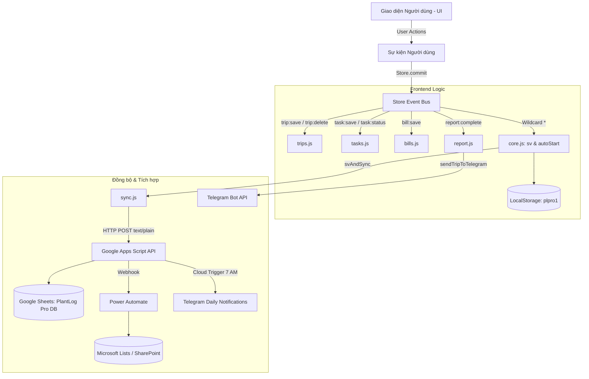

# 🏗️ CẤU TRÚC DỰ ÁN PLANTLOG PRO (PROJECT STRUCTURE)

> **Dự án:** VCS PlantLog Pro — Field Visit & Plant Report Progressive Web App  
> **Phiên bản:** v4.8 (Cập nhật: 25/09/2026)  
> **Đường dẫn gốc:** `d:\AI Lean\Plantlog-pro-main\`  
> **Kiểu kiến trúc:** Modular PWA · Zero Build Step · Offline-first · Event-driven Store · Google Sheets Backend  

---

## 1. 🌳 CÂY THƯ MỤC TỔNG QUAN

```text
Plantlog-pro-main/
│
├── .github/
│   └── workflows/
│       └── deploy.yml                  # CI/CD tự động deploy thư mục src/ lên GitHub Pages
│
├── src/                                # THƯ MỤC TRIỂN KHAI PRODUCTION CHÍNH
│   ├── index.html                      # File giao diện SPA chính (tích hợp đầy đủ CSS/JS/HTML)
│   ├── styles.css                      # Design system (Design tokens, UI components, typography)
│   ├── sw.js                           # Service Worker v13 (Quản lý bộ nhớ đệm Offline PWA)
│   ├── manifest.json                   # Web App Manifest cài đặt PWA độc lập (Standalone)
│   ├── templates.html                  # Khung template HTML các màn hình & modal trích xuất
│   ├── 404.html                        # Chuyển hướng SPA cho GitHub Pages
│   ├── icon-192.png                    # Icon PWA kích thước 192x192
│   ├── icon-512.png                    # Icon PWA kích thước 512x512
│   ├── appsscript.json                 # Cấu hình dự án Apps Script
│   │
│   ├── modules/                        # CÁC ES MODULE CHỨC NĂNG CỐT LÕI (KIẾN TRÚC STORE)
│   │   ├── core.js                     # State, Store pattern, đa ngôn ngữ i18n, PWA, Auto-start
│   │   ├── auth.js                     # Xác thực mã PIN 4 số, SHA-256 hash, màn hình khóa
│   │   ├── trips.js                    # Quản lý Chuyến đi (CRUD, lịch trình, trạng thái, bộ lọc)
│   │   ├── tasks.js                    # Quản lý Nhiệm vụ, Kanban board, Vật tư phụ tùng, Chuyến bay
│   │   ├── report.js                   # Wizard Báo cáo 6 bước, chữ ký cảm ứng Canvas, xuất PDF
│   │   ├── bills.js                    # Quản lý Hóa đơn chi phí, 3 hình thức thanh toán, xuất Bills PDF
│   │   ├── sync.js                     # Đồng bộ 2 chiều Google Sheets qua Apps Script Web App API
│   │   ├── telegram.js                 # Cấu hình và gửi tin nhắn thông báo tự động qua Telegram Bot
│   │   ├── reminders.js                # Quản lý các lịch nhắc định kỳ (Ngày/Tuần/Tháng/Năm)
│   │   ├── calendar.js                 # Tích hợp và đồng bộ lịch trình với Google Calendar
│   │   ├── inspection.js               # Logic kiểm tra thông số kỹ thuật & checklists
│   │   └── library.js                  # Thư viện checklist theo ngành công nghiệp (Dầu khí, Điện, ...)
│   │
│   ├── js/                             # CÁC FILE SCRIPT BIẾN THỂ / TÁCH LẺ THEO COMPONENT
│   │   ├── auth.js                     # Xử lý PIN lock & bảo mật
│   │   ├── bills.js                    # Nghiệp vụ quản lý hóa đơn
│   │   ├── calendar.js                 # Giao diện và logic lịch
│   │   ├── config.js                   # Cấu hình toàn cục
│   │   ├── dashboard.js                # Xử lý thống kê và bảng điều khiển
│   │   ├── pdf.js                      # Tiện ích xuất file PDF (jsPDF)
│   │   ├── profile.js                  # Thông tin cá nhân kỹ sư
│   │   ├── reports.js                  # Xử lý lập báo cáo hiện trường
│   │   ├── settings.js                 # Màn hình cài đặt hệ thống
│   │   ├── state.js                    # Khởi tạo và lưu trữ state
│   │   ├── sync.js                     # Đồng bộ dữ liệu
│   │   ├── tasks.js                    # Nghiệp vụ nhiệm vụ
│   │   ├── trips.js                    # Nghiệp vụ chuyến công tác
│   │   ├── ui.js                       # Render UI & Toast notification
│   │   └── utils.js                    # Các hàm tiện ích format ngày giờ, chuỗi
│   │
│   └── css/
│       └── app.css                     # Stylesheet bổ trợ và responsive
│
├── plantlog_pro_mobile.html            # File standalone (All-in-one HTML) chạy độc lập trực tiếp
├── plantlog_debug.html                 # Bản standalone dùng cho debug / phát triển cục bộ
├── PlantLog_GoogleAppsScript_Pro.gs    # Mã nguồn Backend Google Apps Script (Bản Pro mới nhất)
├── PlantLog_GoogleAppsScript.gs        # Mã nguồn Backend Google Apps Script (Bản chuẩn)
├── appsscript.json                     # Cấu hình runtime & permissions của Google Apps Script
├── README.md                           # Tài liệu tổng quan dự án (Tiếng Anh)
├── CHANGELOG.md                        # Lịch sử cập nhật dự án chi tiết (v4.0 -> v4.8)
├── PROJECT_STRUCTURE.md                # [File này] Cấu trúc chi tiết của toàn bộ dự án
└── PROJECT_INFO.md                     # Tài liệu tổng hợp toàn bộ thông tin dự án
```

---

## 2. 🔍 CHI TIẾT VAI TRÒ TỪNG THÀNH PHẦN

### 2.1. Thư mục `src/` (Production & GitHub Pages Deployment)
Đây là thư mục nguồn được cấu hình trong `.github/workflows/deploy.yml` để triển khai lên GitHub Pages:
* **`index.html` (~9.600 dòng):** Điểm vào chính của ứng dụng web. File này tích hợp trực tiếp layout HTML, CSS Tokens và gom toàn bộ mã nguồn script nhằm tối ưu tốc độ tải và đảm bảo PWA hoạt động mượt mà không gặp rủi ro tải thiếu file qua mạng.
* **`styles.css`:** Chứa Design Tokens chuẩn (hệ màu xanh thương hiệu `Forest Green #0F7B3E`, Warm Slate Neutrals, Spacing, Shadow đa tầng phong cách Notion/Linear/Trello).
* **`sw.js`:** Service Worker phiên bản **`plantlog-pro-v13`**. Tự động dọn dẹp các cache cũ của phiên bản trước, áp dụng chiến lược *Network-First* cho file HTML điều hướng và *Cache-First* cho các tài nguyên tĩnh để hỗ trợ chạy Offline 100%.
* **`manifest.json`:** Định nghĩa tên app `VCS PlantLog Pro`, màu chủ đạo `#00843D`, chế độ hiển thị `standalone` (ẩn thanh địa chỉ trình duyệt khi cài trên điện thoại).

### 2.2. Thư mục `src/modules/` (Kiến trúc Module Hóa)
Toàn bộ logic được chia thành các module chuyên biệt, giao tiếp lỏng lẻo (loose coupling) qua cơ chế **Store Pattern**:
* **`core.js`:**
  * Quản lý State toàn cục `S` (`profile`, `trips`, `tasks`, `bills`, `reports`, `leaveData`, `reminders`, `telegramConfig`, v.v.).
  * Lưu trữ cục bộ an toàn vào `localStorage` với key cô lập `plpro1`.
  * Hỗ trợ đa ngôn ngữ Anh - Việt (i18n).
  * Bộ điều hướng màn hình (`showScreen`), bộ phát thông báo (`showToast`).
  * Hàm `autoStartTodayItems()`: Tự động phát hiện và chuyển Trips/Tasks sang trạng thái `in_progress` khi đến ngày.
* **`auth.js`:**
  * Bảo vệ ứng dụng bằng mã PIN 4 số.
  * Băm mật mã bằng thuật toán SHA-256 kèm salt cô lập (`plprosalt_`).
  * Tự động khóa sau 5 phút không hoạt động hoặc khi mở lại ứng dụng.
* **`trips.js`:**
  * Quản lý vòng đời chuyến đi: `planned` ➔ `in_progress` (Active) ➔ `done` (Completed).
  * Sắp xếp chuyến đi mới nhất lên đầu danh sách chọn bằng `getSortedTrips()`.
  * Đính kèm thông tin chuyến bay, mã đặt chỗ (`PNR`), mã `TA` (Travel Authorization).
* **`tasks.js`:**
  * Quản lý công việc với 5 danh mục: `work`, `travel`, `meeting`, `training`, `leave`.
  * Hỗ trợ 2 chế độ hiển thị: Dạng danh sách (`List`) và Bảng công việc (`Kanban`).
  * Quản lý linh kiện, phụ tùng yêu cầu (`PartsJson`): Tên mã, nhà sản xuất, số lượng, máy móc, trạng thái (*Not Yet / On Order / Ready*). Xuất danh sách vật tư ra Excel và PDF.
* **`report.js`:**
  * Quy trình tạo báo cáo kiểm tra hiện trường 6 bước (Checklist, Readings, Issues, Team, Tasks, Sign-off).
  * Cho phép vẽ và lưu chữ ký điện tử trực tiếp trên màn hình (`HTML5 Canvas`).
  * Xuất tệp PDF báo cáo kỹ thuật thông qua thư viện `jsPDF`: Thể hiện chi tiết nhiệm vụ, mô tả công việc (`Task Description`), chuyến bay, tổng số giờ làm việc / di chuyển / nghỉ phép.
  * Tự động kích hoạt gửi báo cáo qua Telegram khi người dùng bấm hoàn thành (*Mark completed*).
* **`bills.js`:**
  * Quản lý hóa đơn chi phí phát sinh trong chuyến đi.
  * Nhận diện và phân màu 3 hình thức thanh toán: `1-Cash` (Tiền mặt), `2-Bank transfer` (Chuyển khoản), `3-Credit card` (Thẻ tín dụng).
  * Hỗ trợ quy đổi tỷ giá sang VND (`VndAmount`) và chụp ảnh hóa đơn đính kèm.
  * Xuất báo cáo bảng kê chi phí ra file PDF theo từng chuyến đi.
* **`sync.js`:**
  * Phụ trách giao tiếp 2 chiều với Google Sheets.
  * Cơ chế an toàn dữ liệu: Xử lý chuỗi ngày giờ an toàn (`safeDate`, `safeTime`) chống lỗi `1899-12-30`.
  * Bảo vệ trạng thái cục bộ: Không cho phép thao tác kéo dữ liệu từ Sheets đè ngược trạng thái `in_progress` / `done` thành `planned`.
* **`telegram.js`:**
  * Cấu hình Bot Token & Chat ID.
  * Gửi tin nhắn thông báo chuyến đi sắp tới, nhiệm vụ hôm nay và báo cáo tổng kết.
* **`reminders.js` & `calendar.js`:**
  * Quản lý lịch nhắc việc định kỳ và đồng bộ lịch 2 chiều với Google Calendar.
* **`inspection.js` & `library.js`:**
  * Chứa thư viện mẫu kiểm tra checklist theo 6 ngành công nghiệp chính: Dầu khí (Oil & Gas), Năng lượng (Power), Chế tạo (Manufacturing), Hóa chất (Chemical), Xử lý nước (Water), Chế biến thực phẩm (Food).

### 2.3. Backend Serverless (`PlantLog_GoogleAppsScript_Pro.gs`)
File mã nguồn triển khai trên **Google Apps Script** làm backend không máy chủ cho toàn bộ hệ sinh thái:
* **`setupSheets()`:** Khởi tạo bảng tính `PlantLog Pro Database` trên Google Drive với 14 sheet tab chuẩn hóa.
* **`doGet()` & `doPost()`:** Tiếp nhận yêu cầu REST API đồng bộ dữ liệu `syncAll` từ app di động.
* **`autoStartInSheets()`:** Hàm định kỳ chạy lúc 7h sáng, chuẩn hóa ô ngày bằng `parseSheetDateStr_()` và tự động kích hoạt trạng thái `in_progress` trực tiếp trên Google Sheets.
* **`sendDailyTelegramNotifications()`:** Trigger gửi thông báo công việc trong ngày đến Telegram.
* **Bóc tách tab `Flight_TA_Schedule`:** Tự động lọc và đồng bộ các chuyến đi có mã TA/chuyến bay sang tab riêng để kết nối với Microsoft Lists.
* **`pushToPowerAutomateWebhook()`:** Gửi payload thông tin lịch trình bay đến Webhook Power Automate nhằm đồng bộ tự động lên SharePoint / Microsoft Lists của doanh nghiệp.

### 2.4. Các tệp độc lập ở thư mục gốc (Standalone Bundles)
* **`plantlog_pro_mobile.html`:** Bản đóng gói toàn bộ HTML, CSS và JS trong một tệp duy nhất (~535 KB). Kỹ sư có thể tải về máy và mở bằng bất kỳ trình duyệt di động nào mà không cần kết nối mạng hay cài đặt môi trường.
* **`plantlog_debug.html`:** Phiên bản hỗ trợ kiểm thử và gỡ lỗi độc lập.

---

## 3. 🔄 LUỒNG DỮ LIỆU & GIAO TIẾP KIẾN TRÚC (STORE PATTERN)



---

## 4. 📌 QUY TẮC CẦN NHỚ KHI PHÁT TRIỂN TIẾP (MAINTENANCE GUIDELINES)

1. **Đồng bộ song song:** Khi thay đổi logic hoặc UI, cần cập nhật đồng thời ở:
   * Thư mục module: `src/modules/<module_name>.js`
   * File bundle chính: `src/index.html` và `plantlog_pro_mobile.html`
2. **Cập nhật Cache Service Worker:** Khi có sửa đổi trên `src/index.html` hoặc `src/modules/`, luôn tăng phiên bản bộ nhớ đệm trong `src/sw.js` (ví dụ từ `plantlog-pro-v13` lên `plantlog-pro-v14`) để trình duyệt client tự động cập nhật code mới.
3. **Cơ chế chống ghi đè trạng thái:** Tuyệt đối không thay đổi cơ chế bảo vệ trạng thái trong `sync.js` (`loadFromSheets`) để tránh hiện tượng mất trạng thái `in_progress` khi đồng bộ.
